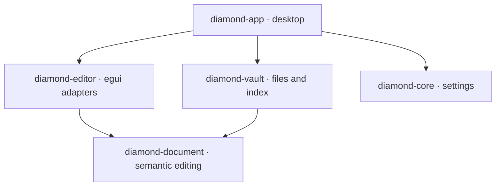

# Diamond architecture

Decision date: 2026-11-19. Platform: Arch Linux (Wayland and X11).

This architecture was written before implementation. The initial implementation is an alpha foundation. `STATUS.md` distinguishes working features from the remaining Obsidian/VS Code scope.

## Product and dependency decisions

The application is native Rust, using pinned egui/eframe 0.33.0 with the OpenGL renderer, native windowing, clipboard and IME. Browser engines are absent from the default workspace. Markdown remains ordinary `.md` files in an ordinary folder. A cache is never the source of truth.

The default UI has a narrow activity rail, resizable vault tree, document tabs,
a centered editor, an optional inspector and a readable status bar. All surfaces,
text, selection and accents use black/gray shades. Controls share an 8/12/16
spacing grid and larger rounded corners. Icons use native vector geometry rather
than font glyphs; the faceted diamond and window icon are grayscale. Animations
are short and time-based; reduced motion disables interpolation.

## Dependency direction

The optional Excalidraw helper lives outside this workspace and runs as a child process. This avoids mixing GTK and winit event loops and avoids linking WebKitGTK into the normal app.

## Native Markdown editing

The document owns a sequence of semantic blocks and inline marks. A caret-aware
projection supplies visible text to egui's native editing machinery. Inactive
supported blocks show semantic text; active blocks reveal their real Markdown
syntax, allowing users to type or erase heading/emphasis markers directly.
There are no formatting buttons. Source-map boundaries translate projection
positions to serialized-source scalar positions, and source transactions reparse
into the authoritative semantic model while retaining undo/redo. Reveal/collapse
remaps the native cursor and selection instead of inserting invisible characters.
Block kinds determine heading/list/quote/code layout and marks determine runs.

The egui `TextBuffer` adapter translates character-index edits into document transactions. One editing surface provides continuous selection, native clipboard and IME. A styled layout is a view of the model, not a second editable copy of Markdown. History belongs to the model, so formatting, task changes and block changes undo together.

The first engine handles a deliberately bounded subset. A real Markdown parser identifies supported structures; constructs the engine cannot faithfully represent remain raw blocks. Untouched blocks retain original bytes, whitespace and newline style. Editing a supported block may canonicalize that block only. Complex tables, nested lists, embeds and extended Markdown need explicit schema work and acceptance tests before being called WYSIWYG-supported. A user can always switch the same document to source mode.

Do not implement hidden zero-width delimiters, draw a preview over an editable source buffer, or create an independent TextEdit for every paragraph. Investigate upstream `egui_richedit` after dependency/API validation; do not rely on a cached `latest` documentation URL for an unverified release.

## Raw/code editing

UTF-8 files use native egui TextEdit with syntax highlighting, line numbers, selection, clipboard, search, replacement and undo. This is the first stage of an independent code editor, not a Monaco wrapper. Binary/non-UTF-8 files use a hexadecimal buffer; committing requires valid hex. No lossy text conversion is permitted.

LSP is a later process boundary speaking JSON-RPC with UTF-16 position conversion. Large files need a rope/piece table and viewport-based layout before advertising VS Code performance. Multicaret, completion, diagnostics, folding and debugger integration are separately tracked. Do not add all of Monaco's scope to a widget file.

## Vault and persistence

Vault files are addressed by validated relative paths beneath a canonical root. Traversal and symlink escape must fail. Disk reads and save outcomes are explicit errors. A save compares the loaded bytes with current disk bytes, writes a temporary file in the same directory, fsyncs it and atomically renames it; failures keep the in-memory document dirty. A last-moment external-write race remains a documented limitation until platform locking/version recovery is added.

The initial searchable index records Markdown title/headings, wikilinks, tags, task completion and backlinks. It can be rebuilt from files. Indexing has bounded file sizes and ignores internal metadata, VCS directories and symlinks. Background workers should publish immutable snapshots through channels; the UI must not acquire a vault-wide write lock.

Tab sessions keep original bytes separate from current editor state. Only `.md`
(case-insensitive) can use formatted mode. Those notes autosave after a 600 ms
typing pause; closing/switching/quitting flushes them first. A conflict latches an
error and keeps the dirty buffer instead of silently retrying. Source and hex
modes retain manual saving and Save/Discard/Cancel. IME preedit is excluded from
autosave and uncommitted composition is cancelled on tab deactivation before
flushing accepted text. Settings are persisted separately in XDG config,
including task progress and reduced motion.

## Excalidraw

The optional helper bundles the upstream React component and its fonts/assets locally. WebKitGTK is the Linux engine; it is not Chromium, but is still a substantial system dependency. No claim of a tiny browser engine is made. The helper only opens explicit `.excalidraw` documents. Rust owns file access, byte conflict checking and atomic save. JS communicates scene JSON through a narrow IPC bridge. Navigation is restricted to the bundled app; no arbitrary webpage is opened inside the bridge.

## Extension policy and parity

Diamond has its own plugin system. Plugins may be written in any language and
communicate with the host through a versioned JSON-over-stdio process protocol.
There is no requirement to implement Obsidian's JavaScript API, CSS themes or
another editor's extension format. The initial protocol supports command
discovery, user-approved text input and proposed replacement text. The GUI shows
the executable, arguments and protocol capabilities before an explicit launch.
Execution and deadlines run on a worker; proposed edits require another user
action and are checked against the originating vault, tab and document bytes.
Protocol capabilities are not an OS sandbox: the plugin process runs with the
user's normal operating-system rights. Loading a vault never runs a plugin.

Sync and Publish are excluded from the product requirements. They are not
planned services or missing parity items. The acceptance matrix tracks the
remaining editor scope explicitly.

## References verified during design

- egui TextEdit and custom layout: https://docs.rs/egui/0.33.0/egui/widgets/text_edit/struct.TextEdit.html
- Native code editor example: https://github.com/emilk/egui/blob/main/crates/egui_demo_lib/src/demo/code_editor.rs
- Semantic rich edit candidate: https://docs.rs/egui_richedit/latest/egui_richedit/
- Markdown offsets: https://docs.rs/pulldown-cmark/latest/pulldown_cmark/struct.OffsetIter.html
- WebKitGTK: https://webkitgtk.org/reference/webkitgtk/stable/
- Excalidraw integration: https://docs.excalidraw.com/docs/@excalidraw/excalidraw/integration

## 0.3 desktop services

Appearance preferences choose Dark/Light/System and accent colors; the default remains neutral. Settings is a normal tab and saves after a debounce. Optional fc-list discovery runs once on a worker; selected fonts are read only after user preference selection. XDG FileChooser uses ashpd/async-io on a worker, with typed cancellation and manual-path fallback on failure. No GTK or web runtime is added. Lucide SVGs are vendored with upstream notices and rasterized to cached textures; user diamond2.svg is discovered at startup.

Filesystem updates use native notify handles for the canonical root and allowed directories, excluding ignored trees and symlinks. Events set bounded atomic flags and request repaint; a one-shot settling deadline and post-registration snapshots rebuild the tree/index. There is no periodic filesystem poll or PollWatcher fallback. Only one index request is active, with a pending follow-up bit. Search compilation and results, line numbers and dirty-state comparisons are cached. Edit-history snapshots are lazy on mutation instead of per idle frame.

## 0.4 document and interface additions

Links carry semantic scalar label ranges and a destination; live editing changes source and reparses, while legacy semantic mutations on link-bearing blocks are declined instead of dropping destinations. Horizontal rules have empty semantic text and native geometric decorations. Task toggles replace the single checkbox source character and use the same history. Unsupported raw syntax keeps its source visible with ordinary text styling.

Language is a persisted core enum with static translations; English is the default. UI and editor font families are separate. Fontconfig is consulted on installation of font preferences, with a bounded local font read and Chinese fallback (noto-fonts-cjk recommended), not during each frame. Tree filtering collects matching ancestors once per frame, avoiding a full descendant scan per folder.

## 0.5 editing and resources

Incomplete list lines are represented independently and blank lines retain exact separators, so unrelated items keep their semantic representation. Caret lookup never falls back across empty gaps or EOF newlines; an unclosed code fence is the explicit exception while its content is being typed. Window focus is included in editing/reveal decisions, and the final repaint predicate uses the same policy as the next frame. No focus-loss repaint timer is introduced.

Tables hold scalar cell ranges, cell text and column alignments; table separators are structural anchors in one native TextEdit. Standalone images are semantic objects with native reserved row height and an alt label. Both retain original source and reveal actual Markdown when edited. Code/table backgrounds are placed in an earlier painter slot under semantic content; no preview is painted over editable source.

A host-supplied image byte loader owns safe filesystem and HTTP policies. The document parser never accesses resources. Local images load only when visible, remote targets only after a load click. Decoding is bounded, runs on at most two worker threads across editors, and wakes the UI on completion. The cache stores downsized textures, not full-resolution decoded images. There is no periodic network/filesystem request. Syntect grammars use the fancy-regex backend without libonig; highlighted runs have a bounded cache keyed by text, language and theme.
