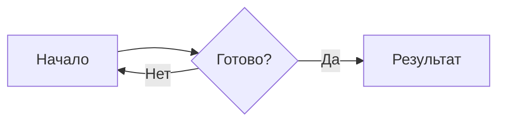

# Mermaid diagrams

Use an ordinary fenced block in a Markdown note:

````markdown

````

Live mode renders a closed `mermaid` fence while the caret is outside it.
Click the diagram or move into the block to edit its literal source. Moving
outside renders again. Source mode always shows code. Open fences remain code;
errors are shown inside a clickable block and never replace the source.

The native backend is mermaid-rs-renderer 0.3.1, with CLI/PNG default features
disabled. Diamond uses its SVG API and the existing resvg renderer, not a browser,
JavaScript runtime, mermaid-cli or a downloaded service. Common families include
flowcharts, sequence/class/state/ER diagrams, pie charts, Gantt, timeline and
mindmap. This native backend does not guarantee every Mermaid.js syntax or
configuration feature. Unsupported input keeps its source and shows an error.
Embedded link/callback scripts do not execute; clicking the image edits code.

Parsing/layout/rasterization run on one lazy worker with a blocking queue.
Only visible inactive blocks request work. Textures are cached by source/theme,
with 64 entries / 64 MiB of texture data, 16 queued jobs, 16 KiB / 256 source
lines, 128 nodes / 256 edges, a 4 MiB SVG limit and a 2048 px raster edge limit.
Completed jobs request a repaint; there is no polling timer or animated spinner.
The note width remains bounded and display height is limited to 900 px.

System fonts are discovered once on the worker; embedded egui fonts provide a
fallback. CJK labels need a suitable installed CJK font. External SVG image hrefs
are disabled. A worker bounds admission and catches renderer panics, but is not
an OS sandbox or a hard execution-time limit for a third-party layout algorithm.

Rust build, native rendering and CPU effects are unverified in the preparation
environment. Regression tests are included but have not run without Cargo.
